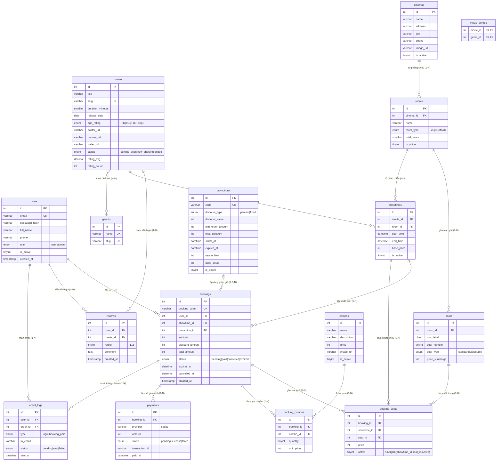

# BÁO CÁO DỰ ÁN HỆ THỐNG WEBSITE BÁN VÉ XEM PHIM TRỰC TUYẾN
## ĐỀ TÀI: PHÁT TRIỂN HỆ THỐNG CINEBOOKING - TRẢI NGHIỆM ĐIỆN ẢNH ĐẲNG CẤP

---

> **Đơn vị thực hiện:** Nhóm Phát Triển Dự Án LTCNPMT2  
> **Tên đề tài:** Hệ Thống Website Đặt Vé Xem Phim Trực Tuyến Tích Hợp Thanh Toán VietQR Tự Động & Soát Vé QR Code  
> **Sản phẩm bàn giao:** Source code Full-Stack (Frontend React + Backend Node.js/Express + Database MySQL)  
> **Repository:** [https://github.com/LTCNPMT2/webphim](https://github.com/LTCNPMT2/webphim)  
> **Thời gian hoàn thành:** Năm 2026  

---

## MỤC LỤC

1. [CHƯƠNG 1: TỔNG QUAN VÀ GIỚI THIỆU ĐỀ TÀI](#chương-1-tổng-quan-và-giới-thiệu-đề-tài)
   - 1.1 Lý do chọn đề tài & Tính cấp thiết
   - 1.2 Mục tiêu nghiên cứu và phát triển
   - 1.3 Phạm vi và đối tượng sử dụng
   - 1.4 Công nghệ kỹ thuật chủ chốt
2. [CHƯƠNG 2: PHÂN TÍCH YÊU CẦU HỆ THỐNG](#chương-2-phân-tích-yêu-cầu-hệ-thống)
   - 2.1 Yêu cầu chức năng (Functional Requirements)
     - 2.1.1 Phân hệ Dành cho Khách hàng (Client User)
     - 2.1.2 Phân hệ Quản trị viên (Admin Portal)
   - 2.2 Yêu cầu phi chức năng (Non-Functional Requirements)
     - 2.2.1 An toàn dữ liệu & Chống giữ trùng ghế (Concurrency Safety)
     - 2.2.2 Bảo mật & Phân quyền (Security & Authorization)
     - 2.2.3 Trải nghiệm người dùng và tính thích ứng thiết bị (Responsive UX)
   - 2.3 Phân tích Use Case và Luồng nghiệp vụ
3. [CHƯƠNG 3: THIẾT KẾ CƠ SỞ DỮ LIỆU & SƠ ĐỒ ERD](#chương-3-thiết-kế-cơ-sở-dữ-liệu--sơ-đồ-erd)
   - 3.1 Sơ đồ Thực thể - Quan hệ (Entity Relationship Diagram - ERD)
   - 3.2 Bảng tổng hợp quan hệ dữ liệu
   - 3.3 Đặc tả chi tiết 16 bảng trong cơ sở dữ liệu `movie_booking`
   - 3.4 Các cơ chế ràng buộc toàn vẹn và tối ưu hóa hiệu năng
4. [CHƯƠNG 4: THIẾT KẾ KIẾN TRÚC VÀ HỆ THỐNG API](#chương-4-thiết-kế-kiến-trúc-và-hệ-thống-api)
   - 4.1 Kiến trúc tổng thể (Client - API Server - MySQL Architecture)
   - 4.2 Thiết kế API Danh mục (Catalog API)
   - 4.3 Thiết kế API Đặt vé & Thanh toán (Booking & Payment API)
   - 4.4 Thiết kế API Xác thực (Authentication API)
   - 4.5 Thiết kế API Quản trị hệ thống (Admin Management API)
5. [CHƯƠNG 5: CHI TIẾT CÁC CHỨC NĂNG CỦA TRANG WEB](#chương-5-chi-tiết-các-chức-năng-của-trang-web)
   - 5.1 Giao diện & Chức năng Khách hàng
     - 5.1.1 Hero Banner Slider Điện Ảnh Đa Tầng
     - 5.1.2 Danh mục Phim Đang Chiếu & Phim Sắp Chiếu
     - 5.1.3 Trang Chi Tiết Phim Đa Tiện Ích
     - 5.1.4 Tiện ích Tra Cứu Lịch Chiếu & Cụm Rạp
     - 5.1.5 Quy trình Đặt vé & Chọn ghế trực quan (Seat Map)
     - 5.1.6 Combo Bắp Nước & Mã Giảm Giá Khuyến Mãi
     - 5.1.7 Thanh toán Tự Động VietQR SePay & Vé Điện Tử Soát QR
     - 5.1.8 Quản lý Hồ Sơ & Lịch Sử Vé Đã Đặt
   - 5.2 Giao diện & Chức năng Phía Quản Trị Viên (Admin)
     - 5.2.1 Dashboard Báo Cáo Doanh Thu & Thống Kê
     - 5.2.2 Quản trị Phim & Upload Poster/Banner
     - 5.2.3 Quản trị Cụm Rạp, Phòng Chiếu & Sơ Đồ Ghế
     - 5.2.4 Quản trị Suất Chiếu & Điều Tiết Giá Vé
     - 5.2.5 Quản trị Đơn Hàng & Soát Vé
     - 5.2.6 Quản trị Combo & Khuyến Mãi
6. [CHƯƠNG 6: CẢI TIẾN THIẾT KẾ: BANNER SLIDER & PHÔNG CHỮ TIẾNG VIỆT](#chương-6-cải-tiến-thiết-kế-banner-slider--phông-chữ-tiếng-việt)
   - 6.1 Nâng cấp hệ thống Typography chuẩn Tiếng Việt (Be Vietnam Pro & Outfit)
   - 6.2 Cải tiến Hero Banner chuẩn Widescreen 21:9 & Ken Burns Effect
   - 6.3 Cơ chế dữ liệu dự phòng (Fallback Resiliency)
7. [CHƯƠNG 7: HƯỚNG DẪN CÀI ĐẶT VÀ VẬN HÀNH HỆ THỐNG](#chương-7-hướng-dẫn-cài-đặt-và-vận-hành-hệ-thống)
   - 7.1 Yêu cầu môi trường
   - 7.2 Hướng dẫn cài đặt Cơ sở dữ liệu (MySQL / XAMPP)
   - 7.3 Cài đặt và cấu hình Backend
   - 7.4 Cài đặt và cấu hình Frontend
   - 7.5 Danh sách tài khoản thử nghiệm
8. [CHƯƠNG 8: KẾT LUẬN VÀ HƯỚNG PHÁT TRIỂN](#chương-8-kết-luận-và-hướng-phát-triển)
   - 8.1 Kết quả đạt được
   - 8.2 Ưu điểm nổi bật của hệ thống
   - 8.3 Hạn chế và Hướng phát triển trong tương lai

---

# CHƯƠNG 1: TỔNG QUAN VÀ GIỚI THIỆU ĐỀ TÀI

### 1.1 Lý do chọn đề tài & Tính cấp thiết
Trong kỷ nguyên số hóa hiện đại, ngành công nghiệp điện ảnh và giải trí tại Việt Nam đang phát triển với tốc độ vượt bậc. Nhu cầu thưởng thức các tác phẩm điện ảnh bom tấn tại rạp chiếu phim (như CGV, BHD, Galaxy, Lotte Cinema, Cinestar) ngày càng gia tăng. Tuy nhiên, phương thức mua vé truyền thống tại quầy vé thường xuyên dẫn đến tình trạng:
* Khán giả phải xếp hàng kéo dài vào các khung giờ cao điểm hoặc dịp công chiếu phim bom tấn.
* Khó khăn trong việc quan sát toàn bộ sơ đồ rạp để lựa chọn vị trí ghế ngồi ưng ý (ghế VIP, ghế Trung tâm, ghế Đôi Sweetbox).
* Bị động trong việc nắm bắt lịch chiếu, thông tin định dạng phòng (2D, 3D, IMAX), diễn viên, trailer và các chương trình khuyến mãi.

Nhằm giải quyết triệt để các hạn chế trên, đề tài **"Xây dựng Hệ thống Website Bán Vé Xem Phim Trực Tuyến CineBooking"** được nghiên cứu và hiện thực hóa. Hệ thống mang đến trải nghiệm toàn diện từ việc tra cứu phim, xem trailer, chọn rạp, giữ ghế theo thời gian thực (Real-time Seat Locking), đặt combo bắp nước, áp dụng mã ưu đãi cho đến thanh toán tức thời qua ngân hàng (VietQR SePay) và nhận vé điện tử thông minh tích hợp mã QR Code soát vé.

### 1.2 Mục tiêu nghiên cứu và phát triển
1. **Xây dựng giải pháp phần mềm hoàn chỉnh**: Bao gồm cả ứng dụng Khách hàng (Client Portal) và trang Quản trị chuyên nghiệp (Admin Portal).
2. **Trải nghiệm người dùng chuẩn điện ảnh (Luxury Cinema UI/UX)**: Giao diện nền tối (Dark Theme `#080b12`), áp dụng hiệu ứng kính mờ (Glassmorphism), ánh sáng môi trường rạp chiếu (Cinema Ambient Glow) và hệ thống phông chữ tối ưu cho tiếng Việt.
3. **Đảm bảo tính toàn vẹn và nhất quán dữ liệu (Concurrency Control)**: Thiết kế giải pháp ngăn chặn hoàn toàn việc hai khách hàng đặt trùng cùng một ghế tại một suất chiếu trong điều kiện tải cao.
4. **Tự động hóa toàn trình**: Tự động xác nhận giao dịch thanh toán qua Webhook của SePay trong vòng vài giây, tự động phát hành vé điện tử kèm mã QR bảo mật chữ ký HMAC và gửi thông báo qua email.

### 1.3 Phạm vi và đối tượng sử dụng
* **Đối tượng người dùng**:
  * *Khách vãng lai (Guest)*: Xem danh sách phim, trailer, lịch chiếu, đánh giá và tìm kiếm thông tin cụm rạp.
  * *Khách hàng thành viên (Member)*: Đặt vé xem phim, giữ ghế trực tuyến, chọn combo bắp nước, thanh toán chuyển khoản, nhận vé điện tử, quản lý lịch sử đơn vé và viết đánh giá bình luận phim.
  * *Quản trị viên (Admin)*: Theo dõi doanh thu theo thời gian thực qua biểu đồ, quản lý phim, quản lý cụm rạp và sơ đồ phòng chiếu, lập lịch suất chiếu, quản lý khuyến mãi và thực hiện soát vé tại cửa phòng chiếu.

### 1.4 Công nghệ kỹ thuật chủ chốt
* **Frontend (Giao diện người dùng)**:
  * **React 18**: Kiến trúc Single Page Application (SPA), lập trình hướng Component, quản lý trạng thái bằng React Hooks & Context API.
  * **Vite 6**: Công cụ build hiện đại siêu tốc, tối ưu bundle và Hot Module Replacement (HMR).
  * **Tailwind CSS v4**: Hệ thống utility-first CSS hiện đại, cấu hình theme linh hoạt (`@theme`), responsive toàn diện trên di động và máy tính để bàn.
  * **React Router DOM v6**: Điều hướng định tuyến phía client, hỗ trợ Route Protection (bảo vệ quyền truy cập Admin và Khách hàng).
  * **Recharts**: Thư viện trực quan hóa dữ liệu biểu đồ doanh thu tài chính chuyên sâu.
  * **QR Code & Hot Toast**: Tạo mã QR soát vé chữ ký số phía client và thông báo toast tương tác thân thiện.
* **Backend (Máy chủ ứng dụng)**:
  * **Node.js & Express.js**: Môi trường chạy JavaScript không đồng bộ, kiến trúc phân tầng (MVC / Routes - Controllers - Services - Models).
  * **JWT (JSON Web Token)**: Cơ chế xác thực người dùng stateless an toàn, thời hạn cấp phát 7 ngày.
  * **Bcrypt.js**: Mã hóa băm mật khẩu một chiều đạt tiêu chuẩn an toàn thông tin.
  * **Nodemailer**: Module truyền tải email giao dịch tự động qua giao thức SMTP (hỗ trợ Gmail SMTP / Brevo / Resend).
* **Database (Cơ sở dữ liệu)**:
  * **MySQL / MariaDB 10.4+**: Hệ quản trị cơ sở dữ liệu quan hệ mạnh mẽ, bảng mã `utf8mb4_unicode_ci` hỗ trợ đầy đủ tiếng Việt có dấu.
  * **Mysql2/Promise Connection Pool**: Quản lý hồ kết nối liên tục, thực thi câu lệnh dưới dạng Prepared Statements chống tuyệt đối lỗ hổng SQL Injection.

---

# CHƯƠNG 2: PHÂN TÍCH YÊU CẦU HỆ THỐNG

### 2.1 Yêu cầu chức năng (Functional Requirements)

```
                            HỆ THỐNG CINEBOOKING
             ┌─────────────────────────┴─────────────────────────┐
             ▼                                                   ▼
     PHÂN HỆ KHÁCH HÀNG                                   PHÂN HỆ QUẢN TRỊ
  ┌───────────────────────┐                           ┌───────────────────────┐
  │ 1. Khám phá Phim      │                           │ 1. Dashboard Thống kê │
  │ 2. Tra cứu Lịch chiếu │                           │ 2. Quản lý Phim       │
  │ 3. Chọn ghế & Combo   │                           │ 3. Quản lý Rạp & Ghế  │
  │ 4. Giữ ghế (10 phút)  │                           │ 4. Quản lý Suất chiếu │
  │ 5. Thanh toán VietQR  │                           │ 5. Quản trị Đơn vé    │
  │ 6. Nhận Vé & QR Code  │                           │ 6. Quản lý Combo/KM   │
  │ 7. Đánh giá phim (10★)│                           │ 7. Soát vé tại quầy   │
  └───────────────────────┘                           └───────────────────────┘
```

#### 2.1.1 Phân hệ Dành cho Khách hàng (Client User)
1. **Khám phá phim & Hero Banner:**
   * Trình chiếu banner động Widescreen 21:9 hiển thị các siêu phẩm bom tấn hot nhất.
   * Danh mục phim phân tách rõ ràng: "Phim Đang Chiếu" (có xếp hạng thứ tự Top 1, Top 2...) và "Phim Sắp Chiếu" (hiển thị ngày khởi chiếu dự kiến).
   * Bộ lọc phim thông minh theo thể loại (Hành động, Tình cảm, Hoạt hình, Kinh dị...), độ tuổi (P, T13, T16, T18) và định dạng chiếu (2D, 3D, IMAX).
   * Thanh tìm kiếm nhanh thời gian thực theo tên phim.
2. **Chi tiết phim & Tương tác truyền thông:**
   * Xem video trailer chính thức từ YouTube qua cửa sổ Popup modal.
   * Thông tin tác phẩm chi tiết: Tóm tắt nội dung, Đạo diễn, Dàn diễn viên (Cast), Cảnh phim (Gallery stills), FAQ câu hỏi thường gặp.
   * Chấm điểm và viết bài cảm nhận đánh giá phim theo thang điểm 10.0 sao, kèm tag cảm xúc.
3. **Tra cứu cụm rạp & Lịch chiếu đa chiều:**
   * Danh sách cụm rạp theo thành phố (Hồ Chí Minh, Hà Nội...).
   * Chọn ngày xem trong tuần (Hôm nay, Ngày mai, 7 ngày tiếp theo).
   * Nhóm các suất chiếu trực quan theo từng cụm rạp và từng định dạng phòng chiếu (Phòng 2D Chuẩn, Phòng IMAX Laser, Phòng 3D).
4. **Quy trình đặt vé 3 bước tiện lợi:**
   * **Bước 1 - Chọn ghế ngồi**: Sơ đồ rạp trực quan thể hiện rõ hàng ghế (A-Z) và số ghế (1-10+), phân loại trực quan: Ghế thường (Standard), Ghế VIP trung tâm, Ghế đôi (Couple Sweetbox). Ghế đã có người đặt sẽ hiển thị màu xám khóa chọn.
   * **Bước 2 - Chọn Combo Bắp Nước**: Tích hợp danh mục bắp rang bơ các vị (Phô mai, Caramel), nước ngọt giải khát, combo cá nhân, combo gia đình.
   * **Bước 3 - Nhập mã khuyến mãi & Xác nhận đơn**: Nhập voucher giảm giá (theo % hoặc số tiền cố định), kiểm tra số tiền tạm tính, số tiền chiết khấu và tổng thanh toán cuối cùng.
5. **Cơ chế giữ ghế tạm thời (Holding Lock):**
   * Khi khách hàng bấm xác nhận chọn ghế, hệ thống lập tức khóa các ghế này trong vòng **10 phút** với đồng hồ đếm ngược thời gian thực.
   * Ngăn chặn người dùng khác chọn trùng ghế trong thời gian thanh toán.
6. **Thanh toán chuyển khoản tự động VietQR & SePay:**
   * Tạo mã QR thanh toán động chứa đầy đủ thông tin: Ngân hàng thụ hưởng, Số tài khoản, Tên chủ tài khoản, Số tiền chính xác và Nội dung chuyển khoản mã đơn hàng (`BK2026xxxx-xxxx`).
   * Tự động bắt tín hiệu xác nhận thanh toán thành công qua SePay Webhook chỉ trong 2-5 giây mà người dùng không cần bấm bất kỳ nút nào hay tải ảnh biên lai chuyển tiền.
7. **Vé điện tử & Mã QR Soát vé thông minh:**
   * Sau khi thanh toán, hệ thống cấp phát vé điện tử hiển thị mã vé, tên phim, phòng chiếu, giờ chiếu, số ghế và danh sách combo.
   * Tích hợp mã QR Code soát vé được ký số HMAC bí mật chống làm giả.
   * Hỗ trợ nút "In vé" định dạng khổ giấy sạch đẹp (tự động loại bỏ nền tối khi in) và tự động gửi vé xác nhận vào hòm thư Email cá nhân.
8. **Quản lý tài khoản cá nhân:**
   * Đăng ký tài khoản mới bằng Email/Mật khẩu hoặc Đăng nhập một chạm bằng Google Account (OAuth2).
   * Cập nhật thông tin cá nhân (Họ tên, Số điện thoại, Ảnh đại diện).
   * Lịch sử đơn đặt vé với các trạng thái: Đã thanh toán (Paid), Chờ thanh toán (Pending), Đã hủy (Cancelled).
   * Hỗ trợ chức năng tự hủy vé hoàn tiền theo quy định (trước giờ chiếu tối thiểu 2 giờ).

#### 2.1.2 Phân hệ Quản trị viên (Admin Portal)
1. **Bảng điều khiển kinh doanh (Dashboard Analytics):**
   * Thống kê tổng doanh thu bán vé toàn hệ thống theo khoảng thời gian tùy chọn (Hôm nay, 7 ngày qua, Tháng này, Toàn thời gian).
   * Tổng số vé đã bán, tổng số đơn đặt, tỷ lệ lấp đầy rạp chiếu (Occupancy Rate).
   * Biểu đồ cột/đường trực quan (Recharts) thể hiện xu hướng doanh thu hàng ngày và biểu đồ đóng góp doanh thu theo từng bộ phim.
2. **Quản lý danh mục phim (Movie Management):**
   * Thêm mới tác phẩm điện ảnh: Tên phim, Slug SEO, Thời lượng, Ngày khởi chiếu, Đạo diễn, Diễn viên chính, Ngôn ngữ, Độ tuổi phân loại, Trạng thái (Sắp chiếu / Đang chiếu / Ngừng chiếu).
   * Upload hình ảnh poster dọc và banner ngang khổ lớn (lưu trữ tại thư mục `/uploads/posters/`).
   * Cấu hình liên kết trailer YouTube, bộ ảnh hậu trường (Gallery JSON) và câu hỏi FAQ.
   * Chỉnh sửa thông tin phim hoặc xóa phim khi cần.
3. **Quản lý cụm rạp, phòng chiếu & sơ đồ ghế:**
   * Quản lý danh sách chi nhánh cụm rạp CineBooking theo từng tỉnh thành.
   * Quản lý phòng chiếu thuộc rạp: Định dạng phòng (2D, 3D, IMAX), số lượng ghế tối đa.
   * Khởi tạo sơ đồ cấu hình ghế theo ma trận tọa độ hàng/cột, thiết lập loại ghế (Thường, VIP, Đôi) và mức phụ thu tương ứng cho từng loại ghế.
4. **Quản lý lịch & suất chiếu (Showtime Scheduling):**
   * Lập lịch suất chiếu: Chọn phim, chọn cụm rạp, chọn phòng chiếu, chọn ngày giờ bắt đầu và giá vé cơ bản (Base price).
   * Hệ thống tự động tính toán thời gian kết thúc của suất chiếu dựa trên thời lượng phim.
   * Kiểm tra tự động xung đột lịch chiếu (tránh lên lịch 2 phim cùng chiếu một phòng tại một thời điểm).
5. **Quản lý chương trình khuyến mãi & Combo bắp nước:**
   * Tạo mã voucher giảm giá: Thiết lập loại giảm (theo phần trăm hoặc tiền mặt), mức giảm tối đa, đơn hàng tối thiểu, ngày bắt đầu, ngày hết hạn và giới hạn số lượt sử dụng.
   * Quản lý menu combo ăn uống: Tên gói combo, mô tả thành phần, đơn giá bán, ảnh minh họa.
6. **Quản lý đơn hàng & Soát vé tại cửa phòng:**
   * Tra cứu toàn bộ danh sách đơn đặt vé theo mã đơn hàng, email khách hàng, ngày đặt vé hoặc trạng thái đơn.
   * Công cụ soát vé tại quầy: Quét mã QR trên vé của khách để kiểm tra tính hợp lệ và đánh dấu vé đã được sử dụng.

### 2.2 Yêu cầu phi chức năng (Non-Functional Requirements)

#### 2.2.1 An toàn dữ liệu & Chống giữ trùng ghế (Concurrency Safety)
* **Thách thức:** Tại thời điểm phim bom tấn mở bán vé, hàng nghìn khách hàng có thể cùng truy cập và bấm chọn cùng một vị trí ghế ngồi (ghế trung tâm, ghế VIP hàng E-F).
* **Giải pháp kỹ thuật của hệ thống:**
  1. Sử dụng ràng buộc cơ sở dữ liệu cấp thấp: `UNIQUE KEY unique_active_seat (showtime_id, seat_id, active)`. Cột `active` nhận giá trị `1` khi ghế đang được giữ hoặc đã bán. Nhờ đó, MySQL sẽ từ chối ngay lập tức bằng lỗi Duplicate Key nếu có luồng thứ hai cố tình giữ cùng ghế.
  2. Kết hợp kỹ thuật Transaction và câu lệnh khóa bi quan `SELECT ... FOR UPDATE` khi đọc dữ liệu ghế để phân định thứ tự ưu tiên tuyệt đối cho người bấm trước.
  3. Khi đơn đặt vé hết hạn thời gian giữ chỗ (sau 10 phút) hoặc bị hủy, hệ thống thực thi `UPDATE booking_seats SET active = NULL WHERE booking_id = ?`. Vì MySQL cho phép lưu nhiều giá trị `NULL` trong chỉ mục UNIQUE, nên ghế lập tức được giải phóng cho người khác chọn mà vẫn bảo tồn toàn vẹn dữ liệu lịch sử đặt vé.

#### 2.2.2 Bảo mật & Phân quyền (Security & Authorization)
* **Xác thực JWT**: Token ký bằng thuật toán HMAC SHA-256 kèm thời hạn hết hạn (`expiresIn: '7d'`), lưu trữ an toàn và đính kèm tự động trong header `Authorization: Bearer <token>` qua Axios Interceptor.
* **Mã hóa mật khẩu**: Băm bằng thư viện `bcryptjs` với salt rounds chuẩn 10, ngăn chặn việc lộ mật khẩu ngay cả khi cơ sở dữ liệu bị trích xuất trái phép.
* **Phân quyền vai trò (Role-Based Access Control - RBAC)**: Middleware `authMiddleware` và `adminMiddleware` kiểm tra chặt chẽ quyền hạn trước khi cho phép truy cập các tài nguyên quản trị nhạy cảm.
* **Chống gian lận vé (Anti-Fraud QR Code)**: Dữ liệu mã QR trên vé được mã hóa kèm chữ ký HMAC bí mật (`crypto.createHmac('sha256', secret)`). Người dùng không thể tự ý sửa đổi số ghế hay mã vé để vào rạp.
* **Bảo vệ cổng thanh toán SePay**: Xác thực Webhook secret token từ máy chủ ngân hàng SePay, kiểm tra đối soát số tài khoản thụ hưởng và số tiền giao dịch trước khi cập nhật đơn hàng sang trạng thái `paid`.

#### 2.2.3 Trải nghiệm người dùng và tính thích ứng thiết bị (Responsive UX)
* Giao diện tương thích 100% trên mọi kích thước màn hình: Điện thoại thông minh (iPhone, Android 375px+), Máy tính bảng (iPad 768px+) và Màn hình máy tính để bàn (1280px, 1920px Full HD).
* Tốc độ phản hồi cực nhanh nhờ kiến trúc Single Page Application, chỉ tải dữ liệu JSON cần thiết mà không phải tải lại toàn bộ trang web.
* Cung cấp cơ chế dự phòng dữ liệu mẫu (*Graceful Degradation*): Giao diện banner và danh mục phim vẫn hiển thị lung linh, sắc nét ngay cả khi máy chủ backend đang bảo trì hoặc mạng gián đoạn.

---

# CHƯƠNG 3: THIẾT KẾ CƠ SỞ DỮ LIỆU & SƠ ĐỒ ERD

### 3.1 Sơ đồ Thực thể - Quan hệ (Entity Relationship Diagram - ERD)

Dưới đây là sơ đồ kiến trúc dữ liệu thực thể của hệ thống CineBooking thể hiện đầy đủ các bảng dữ liệu, khóa chính (PK), khóa ngoại (FK) và mối quan hệ liên kết giữa các bảng:



### 3.2 Bảng tổng hợp quan hệ dữ liệu

| STT | Bảng nguồn | Quan hệ | Bảng đích | Khóa liên kết | Diễn giải ý nghĩa nghiệp vụ |
|:---:|:---|:---:|:---|:---|:---|
| 1 | `users` | 1 - N | `bookings` | `bookings.user_id = users.id` | Một khách hàng có thể đặt nhiều đơn vé xem phim |
| 2 | `cinemas` | 1 - N | `rooms` | `rooms.cinema_id = cinemas.id` | Một cụm rạp bao gồm nhiều phòng chiếu phim |
| 3 | `rooms` | 1 - N | `seats` | `seats.room_id = rooms.id` | Một phòng chiếu được bố trí sơ đồ gồm nhiều ghế ngồi |
| 4 | `movies` | 1 - N | `showtimes` | `showtimes.movie_id = movies.id` | Một tác phẩm điện ảnh có nhiều lịch suất chiếu khác nhau |
| 5 | `rooms` | 1 - N | `showtimes` | `showtimes.room_id = rooms.id` | Một phòng chiếu tổ chức nhiều suất chiếu theo các khung giờ |
| 6 | `movies` | N - N | `genres` | Qua bảng trung gian `movie_genres` | Một phim có nhiều thể loại; một thể loại thuộc nhiều phim |
| 7 | `showtimes` | 1 - N | `bookings` | `bookings.showtime_id = showtimes.id` | Một suất chiếu tiếp nhận nhiều đơn đặt vé của khách |
| 8 | `promotions`| 0..1 - N | `bookings` | `bookings.promotion_id = promotions.id`| Một mã ưu đãi có thể được áp dụng cho nhiều đơn vé khác nhau |
| 9 | `bookings` | 1 - N | `booking_seats`| `booking_seats.booking_id = bookings.id`| Một đơn đặt vé bao gồm 1 hoặc nhiều vé ghế ngồi |
| 10 | `seats` | 1 - N | `booking_seats`| `booking_seats.seat_id = seats.id` | Một chiếc ghế được ghi nhận trong lịch sử các lần đặt vé |
| 11 | `bookings` | 1 - N | `booking_combos`| `booking_combos.booking_id = bookings.id`| Một đơn hàng có thể mua kèm nhiều loại combo bắp nước |
| 12 | `combos` | 1 - N | `booking_combos`| `booking_combos.combo_id = combos.id` | Một gói combo bắp nước được bán trong nhiều đơn hàng |
| 13 | `bookings` | 1 - N | `payments` | `payments.booking_id = bookings.id` | Một đơn hàng ghi nhận lịch sử giao dịch thanh toán |
| 14 | `users` | 1 - N | `reviews` | `reviews.user_id = users.id` | Một người dùng có thể viết đánh giá cho nhiều bộ phim |
| 15 | `movies` | 1 - N | `reviews` | `reviews.movie_id = movies.id` | Một bộ phim nhận được nhiều bình luận đánh giá từ khán giả |
| 16 | `bookings` | 1 - 1 | `email_logs` | `email_logs.order_id = bookings.id` | Mỗi đơn vé thanh toán chỉ gửi duy nhất 1 email xác nhận |

---

### 3.3 Đặc tả chi tiết 16 bảng trong cơ sở dữ liệu `movie_booking`

#### 1. Bảng `users` (Tài khoản người dùng & Quản trị viên)
Lưu trữ hồ sơ tài khoản khách hàng và ban quản trị.
* `id` (INT UNSIGNED, PK, Auto Inc): Mã định danh người dùng.
* `full_name` (VARCHAR(100), NOT NULL): Họ và tên người dùng.
* `email` (VARCHAR(150), NOT NULL, UNIQUE): Email đăng nhập tài khoản.
* `password_hash` (VARCHAR(255), NOT NULL): Chuỗi mật khẩu băm Bcrypt.
* `phone` (VARCHAR(20), NULL): Số điện thoại liên hệ nhận vé.
* `avatar_url` (VARCHAR(255), NULL): Đường dẫn ảnh đại diện.
* `role` (ENUM('user', 'admin'), NOT NULL, DEFAULT 'user'): Phân quyền người dùng.
* `is_active` (TINYINT(1), NOT NULL, DEFAULT 1): Trạng thái (1: Hoạt động, 0: Đang khóa).
* `created_at`, `updated_at` (TIMESTAMP): Thời gian khởi tạo và cập nhật.

#### 2. Bảng `cinemas` (Cụm rạp chiếu phim)
* `id` (INT UNSIGNED, PK, Auto Inc): Mã cụm rạp.
* `name` (VARCHAR(150), NOT NULL): Tên rạp (VD: Cinema Sài Gòn Center).
* `address` (VARCHAR(255), NOT NULL): Địa chỉ chi tiết.
* `city` (VARCHAR(100), NOT NULL): Tỉnh/Thành phố (TP. Hồ Chí Minh, Hà Nội...).
* `phone` (VARCHAR(20), NULL): Số hotline liên hệ.
* `image_url` (VARCHAR(255), NULL): Ảnh chụp khuôn viên rạp.
* `is_active` (TINYINT(1), NOT NULL, DEFAULT 1): Trạng thái mở cửa.

#### 3. Bảng `rooms` (Phòng chiếu phim)
* `id` (INT UNSIGNED, PK, Auto Inc): Mã phòng chiếu.
* `cinema_id` (INT UNSIGNED, NOT NULL, FK `cinemas.id`): Thuộc rạp nào.
* `name` (VARCHAR(50), NOT NULL): Tên phòng (Phòng 1, Phòng 2 (IMAX)...).
* `room_type` (ENUM('2D', '3D', 'IMAX'), NOT NULL, DEFAULT '2D'): Định dạng phòng.
* `total_seats` (SMALLINT UNSIGNED, NOT NULL, DEFAULT 0): Tổng số ghế.
* `is_active` (TINYINT(1), NOT NULL, DEFAULT 1): Trạng thái hoạt động.
* *Ràng buộc*: `UNIQUE (cinema_id, name)`.

#### 4. Bảng `seats` (Sơ đồ ghế ngồi chi tiết)
* `id` (INT UNSIGNED, PK, Auto Inc): Mã định danh ghế ngồi.
* `room_id` (INT UNSIGNED, NOT NULL, FK `rooms.id`): Thuộc phòng chiếu nào.
* `row_label` (CHAR(1), NOT NULL): Ký tự hàng ghế (A, B, C, D, E, F...).
* `seat_number` (TINYINT UNSIGNED, NOT NULL): Số ghế trong hàng (1, 2, 3...).
* `seat_type` (ENUM('standard', 'vip', 'couple'), NOT NULL): Phân loại ghế.
* `price_surcharge` (INT UNSIGNED, NOT NULL, DEFAULT 0): Tiền phụ thu theo loại ghế (VNĐ).
* *Ràng buộc*: `UNIQUE (room_id, row_label, seat_number)`.

#### 5. Bảng `genres` (Danh mục Thể loại phim)
* `id` (INT UNSIGNED, PK, Auto Inc): Mã thể loại.
* `name` (VARCHAR(50), NOT NULL, UNIQUE): Tên thể loại (Hành Động, Kinh Dị...).
* `slug` (VARCHAR(50), NOT NULL, UNIQUE): Đường dẫn SEO thân thiện (hanh-dong, kinh-di).

#### 6. Bảng `movies` (Tác phẩm điện ảnh)
* `id` (INT UNSIGNED, PK, Auto Inc): Mã phim.
* `title` (VARCHAR(255), NOT NULL): Tên phim.
* `tagline` (VARCHAR(255), NULL): Câu khẩu hiệu nổi bật của phim.
* `slug` (VARCHAR(255), NOT NULL, UNIQUE): Đường dẫn định danh URL.
* `description` (TEXT, NULL): Tóm tắt nội dung cốt truyện.
* `duration_minutes` (SMALLINT UNSIGNED, NOT NULL): Thời lượng chiếu (phút).
* `release_date` (DATE, NOT NULL): Ngày phát hành chính thức.
* `director` (VARCHAR(150), NULL): Tên đạo diễn.
* `cast_members` (TEXT, NULL): Danh sách diễn viên chính ngắn gọn.
* `language` (VARCHAR(50), DEFAULT 'Tiếng Việt'): Ngôn ngữ / Phụ đề.
* `country` (VARCHAR(100), DEFAULT 'Việt Nam'): Quốc gia sản xuất.
* `age_rating` (ENUM('P', 'K', 'T13', 'T16', 'T18', 'C'), NOT NULL): Nhãn độ tuổi khán giả.
* `poster_url` (VARCHAR(255), NULL): Đường dẫn ảnh poster dọc.
* `banner_url` (VARCHAR(255), NULL): Đường dẫn ảnh banner ngang khổ lớn.
* `trailer_url` (VARCHAR(255), NULL): Link video trailer YouTube.
* `status` (ENUM('coming_soon', 'now_showing', 'ended'), NOT NULL): Trạng thái phim.
* `rating_avg` (DECIMAL(4,2), NOT NULL, DEFAULT 0.00): Điểm sao trung bình thang 10.0.
* `rating_count` (INT UNSIGNED, NOT NULL, DEFAULT 0): Tổng số lượt đánh giá.

#### 7. Bảng `movie_genres` (Liên kết Nhiều - Nhiều Phim & Thể loại)
* `movie_id` (INT UNSIGNED, NOT NULL, PK, FK `movies.id`).
* `genre_id` (INT UNSIGNED, NOT NULL, PK, FK `genres.id`).

#### 8. Bảng `showtimes` (Lịch & Suất chiếu rạp)
* `id` (INT UNSIGNED, PK, Auto Inc): Mã suất chiếu.
* `movie_id` (INT UNSIGNED, NOT NULL, FK `movies.id`): Phim được chiếu.
* `room_id` (INT UNSIGNED, NOT NULL, FK `rooms.id`): Phòng chiếu.
* `start_time` (DATETIME, NOT NULL): Thời gian bắt đầu.
* `end_time` (DATETIME, NOT NULL): Thời gian kết thúc.
* `base_price` (INT UNSIGNED, NOT NULL): Giá vé gốc áp dụng cho suất chiếu.
* `is_active` (TINYINT(1), NOT NULL, DEFAULT 1): Trạng thái mở bán vé.

#### 9. Bảng `combos` (Combo Bắp Rang & Nước Uống)
* `id` (INT UNSIGNED, PK, Auto Inc): Mã combo.
* `name` (VARCHAR(100), NOT NULL): Tên gói combo (VD: Combo Bắp Phô Mai + 2 Nước).
* `description` (VARCHAR(255), NULL): Thành phần gói combo.
* `price` (INT UNSIGNED, NOT NULL): Giá bán lẻ (VNĐ).
* `image_url` (VARCHAR(255), NULL): Ảnh minh họa sản phẩm.
* `is_active` (TINYINT(1), NOT NULL, DEFAULT 1): Trạng thái đang bán.

#### 10. Bảng `promotions` (Chính sách Khuyến mãi & Giảm giá)
* `id` (INT UNSIGNED, PK, Auto Inc): Mã khuyến mãi.
* `code` (VARCHAR(30), NOT NULL, UNIQUE): Mã voucher nhập khi thanh toán (VD: `CINEVIP20`).
* `description` (VARCHAR(255), NULL): Mô tả ưu đãi.
* `discount_type` (ENUM('percent', 'fixed'), NOT NULL): Giảm theo % hoặc số tiền cố định.
* `discount_value` (INT UNSIGNED, NOT NULL): Giá trị giảm (% hoặc VNĐ).
* `min_order_amount` (INT UNSIGNED, NOT NULL, DEFAULT 0): Giá trị đơn hàng tối thiểu.
* `max_discount` (INT UNSIGNED, NULL): Mức giảm trần tối đa khi giảm theo %.
* `starts_at`, `expires_at` (DATETIME, NOT NULL): Khung thời gian áp dụng mã.
* `usage_limit` (INT UNSIGNED, NULL): Giới hạn số lượt dùng toàn hệ thống.
* `used_count` (INT UNSIGNED, NOT NULL, DEFAULT 0): Số lượt đã sử dụng.
* `is_active` (TINYINT(1), NOT NULL, DEFAULT 1): Hiệu lực của mã.

#### 11. Bảng `bookings` (Đơn đặt vé xem phim)
* `id` (INT UNSIGNED, PK, Auto Inc): Mã đơn hàng nội bộ.
* `booking_code` (VARCHAR(20), NOT NULL, UNIQUE): Mã đơn hiển thị (VD: `BK20261029-4567`).
* `user_id` (INT UNSIGNED, NOT NULL, FK `users.id`): Khách hàng đặt vé.
* `showtime_id` (INT UNSIGNED, NOT NULL, FK `showtimes.id`): Suất chiếu phim.
* `promotion_id` (INT UNSIGNED, NULL, FK `promotions.id`): Mã voucher áp dụng.
* `subtotal` (INT UNSIGNED, NOT NULL, DEFAULT 0): Tiền tạm tính (Ghế + Combo).
* `discount_amount` (INT UNSIGNED, NOT NULL, DEFAULT 0): Số tiền chiết khấu giảm giá.
* `total_amount` (INT UNSIGNED, NOT NULL, DEFAULT 0): Tổng tiền thực tế cần thanh toán.
* `status` (ENUM('pending', 'paid', 'cancelled', 'expired'), NOT NULL, DEFAULT 'pending'): Trạng thái đơn.
* `expires_at` (DATETIME, NULL): Hạn chót thanh toán giữ ghế (mặc định 10 phút sau khi tạo).
* `cancelled_at` (DATETIME, NULL): Thời điểm hủy đơn vé.
* `created_at`, `updated_at` (TIMESTAMP): Thời gian tạo và cập nhật đơn hàng.

#### 12. Bảng `booking_seats` (Chi tiết ghế đặt trong đơn hàng)
* `id` (INT UNSIGNED, PK, Auto Inc): Mã bản ghi.
* `booking_id` (INT UNSIGNED, NOT NULL, FK `bookings.id`): Thuộc đơn hàng nào.
* `showtime_id` (INT UNSIGNED, NOT NULL, FK `showtimes.id`): Thuộc suất chiếu nào.
* `seat_id` (INT UNSIGNED, NOT NULL, FK `seats.id`): Ghế ngồi được chọn.
* `price` (INT UNSIGNED, NOT NULL): Giá bán thực tế của ghế (Base price + Surcharge).
* `active` (TINYINT(1), NULL, DEFAULT 1): Trạng thái giữ ghế (1: Đang giữ/Đã mua, NULL: Đã nhả ghế).
* *Ràng buộc cốt lõi*: `UNIQUE (showtime_id, seat_id, active)`.

#### 13. Bảng `booking_combos` (Chi tiết combo bắp nước trong đơn hàng)
* `id` (INT UNSIGNED, PK, Auto Inc): Mã chi tiết combo.
* `booking_id` (INT UNSIGNED, NOT NULL, FK `bookings.id`): Thuộc đơn hàng nào.
* `combo_id` (INT UNSIGNED, NOT NULL, FK `combos.id`): Gói combo được chọn.
* `quantity` (TINYINT UNSIGNED, NOT NULL, DEFAULT 1): Số lượng combo đặt mua.
* `unit_price` (INT UNSIGNED, NOT NULL): Đơn giá tại thời điểm đặt hàng.
* *Ràng buộc*: `UNIQUE (booking_id, combo_id)`.

#### 14. Bảng `payments` (Lịch sử giao dịch thanh toán tài chính)
* `id` (INT UNSIGNED, PK, Auto Inc): Mã giao dịch.
* `booking_id` (INT UNSIGNED, NOT NULL, FK `bookings.id`): Thanh toán cho đơn nào.
* `provider` (VARCHAR(50), NOT NULL, DEFAULT 'sepay'): Cổng thanh toán (VietQR SePay).
* `amount` (INT UNSIGNED, NOT NULL): Số tiền thực tế chuyển khoản thành công.
* `status` (ENUM('pending', 'success', 'failed'), NOT NULL, DEFAULT 'pending').
* `transaction_id` (VARCHAR(100), NULL): Mã giao dịch tham chiếu từ phía ngân hàng/SePay.
* `paid_at` (DATETIME, NULL): Thời gian xác nhận tiền vào tài khoản.

#### 15. Bảng `reviews` (Đánh giá & Nhận xét phim)
* `id` (INT UNSIGNED, PK, Auto Inc): Mã nhận xét.
* `user_id` (INT UNSIGNED, NOT NULL, FK `users.id`): Người viết bài đánh giá.
* `movie_id` (INT UNSIGNED, NOT NULL, FK `movies.id`): Phim được đánh giá.
* `rating` (TINYINT UNSIGNED, NOT NULL): Điểm chấm từ 1 đến 5 sao (quy đổi thang 10.0).
* `comment` (TEXT, NULL): Lời nhận xét cảm nghĩ của khán giả.
* *Ràng buộc*: `UNIQUE (user_id, movie_id)` (Mỗi người chỉ đánh giá 1 lần cho mỗi phim).

#### 16. Bảng `email_logs` (Nhật ký gửi Email tự động)
* `id` (INT UNSIGNED, PK, Auto Inc): Mã log email.
* `user_id` (INT UNSIGNED, NULL, FK `users.id`): Người nhận.
* `order_id` (INT UNSIGNED, NULL, FK `bookings.id`): Đơn hàng gửi vé đính kèm.
* `type` (ENUM('login', 'booking_paid'), NOT NULL): Loại email (Báo đăng nhập hoặc Gửi vé điện tử).
* `to_email` (VARCHAR(150), NOT NULL): Địa chỉ email đích.
* `status` (ENUM('pending', 'sent', 'failed'), NOT NULL, DEFAULT 'pending').
* `sent_at` (DATETIME, NULL): Thời gian gửi thư thành công.
* *Ràng buộc*: `UNIQUE (order_id, type)` (Cơ chế Idempotent chống gửi trùng lặp email vé).

---

# CHƯƠNG 4: THIẾT KẾ KIẾN TRÚC VÀ HỆ THỐNG API

### 4.1 Kiến trúc tổng thể hệ thống

Hệ thống CineBooking được xây dựng dựa trên mô hình Client - Server hiện đại với kiến trúc phân tầng độc lập:

```
[ Khách Hàng Web / Mobile ]
           │  (HTTPS / RESTful JSON)
           ▼
[ Nginx Reverse Proxy / Vite Dev Server ]
           │  (Port 5000)
           ▼
[ Node.js / Express.js Backend Server ]
 ├── [ Authentication Middleware (JWT & Google OAuth) ]
 ├── [ Rate Limiter & Helmet Security Headers ]
 ├── [ Business Logic Controllers (MVC Pattern) ]
 └── [ Services: SePay Webhook, Nodemailer SMTP, Concurrency Lock ]
           │  (MySQL2 Connection Pool with Prepared Statements)
           ▼
[ MySQL 8.0+ Database (16 Tables - utf8mb4) ]
```

### 4.2 Thiết kế API Danh mục (Catalog API)
* `GET /api/movies`: Lấy danh sách phim có phân trang, hỗ trợ lọc theo trạng thái (`now_showing`, `coming_soon`), thể loại, độ tuổi và từ khóa tìm kiếm.
* `GET /api/movies/:id`: Lấy chi tiết thông tin tác phẩm điện ảnh (đạo diễn, diễn viên, gallery, câu hỏi FAQ, điểm đánh giá).
* `GET /api/genres`: Lấy toàn bộ danh mục thể loại phim điện ảnh.
* `GET /api/cinemas`: Lấy danh sách chi nhánh cụm rạp CineBooking theo khu vực địa lý.
* `GET /api/showtimes`: Lấy danh sách suất chiếu phim theo ngày và rạp chiếu, tự động nhóm dữ liệu theo từng cụm rạp.
* `GET /api/movies/:id/reviews`: Lấy danh sách đánh giá của phim kèm điểm trung bình sao.
* `POST /api/movies/:id/reviews`: Viết bình luận đánh giá phim mới (Yêu cầu đăng nhập).

### 4.3 Thiết kế API Đặt vé & Thanh toán (Booking & Payment API)
* `GET /api/bookings/showtime/:showtimeId/seats`: Lấy sơ đồ ghế chi tiết của suất chiếu. Trả về trạng thái từng ghế: Ghế trống, Ghế đang được giữ (Pending Holding), Ghế đã bán (Sold) và loại ghế (Standard, VIP, Couple).
* `POST /api/bookings`: Khởi tạo đơn giữ chỗ (Tạo booking trạng thái `pending`, cấp phát mã đơn, khóa giữ ghế trong 10 phút).
* `POST /api/bookings/:id/apply-promo`: Kiểm tra và áp dụng mã voucher giảm giá vào đơn hàng.
* `GET /api/bookings/:id`: Lấy thông tin chi tiết đơn hàng và trạng thái thanh toán.
* `POST /api/bookings/:id/cancel`: Khách hàng chủ động hủy đơn vé (nếu thỏa mãn điều kiện hủy trước 2 giờ).
* `POST /api/webhook/sepay`: Nhận tín hiệu xác nhận thanh toán chuyển khoản ngân hàng từ SePay, đối soát mã đơn, tự động kích hoạt vé sang `paid` và kích hoạt luồng gửi email vé.

### 4.4 Thiết kế API Xác thực (Authentication API)
* `POST /api/auth/register`: Đăng ký tài khoản người dùng mới (kiểm tra email trùng, mã hóa mật khẩu Bcrypt).
* `POST /api/auth/login`: Đăng nhập hệ thống, kiểm tra mật khẩu, cấp phát mã thông báo JWT Token.
* `POST /api/auth/google`: Đăng nhập hoặc tạo mới tài khoản bằng mã Google OAuth2 Token.
* `GET /api/auth/me`: Lấy thông tin cá nhân của người dùng hiện tại đang đăng nhập.
* `PUT /api/auth/profile`: Cập nhật thông tin họ tên, số điện thoại, ảnh đại diện.

### 4.5 Thiết kế API Quản trị hệ thống (Admin Management API)
* `GET /api/admin/dashboard`: Thống kê doanh thu, số vé, tỷ lệ lấp đầy rạp và dữ liệu biểu đồ phân tích.
* `POST /api/admin/movies` & `PUT /api/admin/movies/:id`: Thêm/Sửa thông tin phim và tải lên ảnh poster/banner.
* `DELETE /api/admin/movies/:id`: Xóa phim khỏi hệ thống.
* `POST /api/admin/showtimes`: Lên lịch suất chiếu mới với cơ chế tự kiểm tra xung đột phòng chiếu.
* `GET /api/admin/bookings`: Tra cứu danh sách đơn vé toàn hệ thống có lọc theo ngày và trạng thái.
* `POST /api/admin/tickets/verify`: Soát vé QR Code tại cửa phòng chiếu phim.

---

# CHƯƠNG 5: CHI TIẾT CÁC CHỨC NĂNG CỦA TRANG WEB

### 5.1 Giao diện & Chức năng Khách hàng

#### 5.1.1 Hero Banner Slider Điện Ảnh Đa Tầng
* Hiển thị ngay đầu trang chủ với tỉ lệ khung hình chuẩn Widescreen 21:9 điện ảnh (`BannerSlider.jsx`).
* Trình chiếu hình ảnh các phim bom tấn nổi bật kèm hiệu ứng phóng nhẹ hình ảnh (Ken Burns Zoom effect).
* Các huy hiệu thông tin hiển thị rõ: Huy hiệu Spotlight (`⚡ Siêu Bom Tấn IMAX`), nhãn phân loại độ tuổi (`P`, `T13`, `T16`, `T18`), điểm sao vàng trung bình (`★ 9.6`), thời lượng phim và các định dạng phòng chiếu sẵn có.
* Cụm nút bấm tương tác nhanh: Nút "🎟️ Đặt vé ngay" mở ngay giao diện chọn rạp và ghế, nút "▶ Xem Trailer" mở video YouTube và nút "Chi tiết phim".
* Tích hợp thanh tiến trình tự động chạy (Auto-play Progress Bar) và dải thumbnail thu nhỏ cho phép người dùng click chuyển nhanh tới phim yêu thích.

#### 5.1.2 Danh mục Phim Đang Chiếu & Phim Sắp Chiếu
* **Phim Đang Chiếu**: Thiết kế dạng thanh trượt Slider hiện đại kết hợp số thứ tự xếp hạng phòng vé khổ lớn (Top 1, Top 2, Top 3...). Mỗi thẻ phim hiển thị poster sắc nét, nút Play xem trailer tròn ở giữa thẻ, nhãn độ tuổi và điểm đánh giá.
* **Phim Sắp Chiếu**: Cung cấp thông tin ngày khởi chiếu chính thức, giúp khán giả chủ động lên kế hoạch đón xem các tác phẩm sắp ra rạp.

#### 5.1.3 Trang Chi Tiết Phim Đa Tiện Ích
* Banner nền mở rộng toàn màn hình với hiệu ứng làm mờ nghệ thuật (Cinematic Backdrop Blur).
* Khu vực thông tin tác phẩm: Tên phim, tagline ấn tượng, thời lượng, đạo diễn, quốc gia sản xuất, tóm tắt cốt truyện.
* Trình phát video Trailer YouTube chuẩn HD không quảng cáo.
* Bảng danh sách diễn viên (Cast Gallery) kèm hình đại diện và vai diễn tương ứng.
* Bộ ảnh cảnh phim (Stills Gallery) cho phép khán giả chiêm ngưỡng các thước phim đẹp.
* Khu vực đánh giá: Thống kê tổng số đánh giá, tỷ lệ sao trung bình và danh sách các bình luận từ khán giả đã xem phim.

#### 5.1.4 Tiện ích Tra Cứu Lịch Chiếu & Cụm Rạp
* Tra cứu đa điểm rạp: Khán giả dễ dàng chuyển đổi qua lại giữa các cụm rạp tại TP. Hồ Chí Minh và Hà Nội.
* Lịch theo ngày: Cho phép chọn nhanh các ngày trong tuần (Hôm nay, Ngày mai và các ngày kế tiếp).
* Danh sách khung giờ chiếu trực quan: Phân loại theo định dạng 2D Chuẩn, 3D và IMAX Laser. Bấm vào khung giờ sẽ lập tức dẫn đến sơ đồ ghế của suất chiếu đó.

#### 5.1.5 Quy trình Đặt vé & Chọn ghế trực quan (Seat Map)
* Thiết kế mô phỏng phòng chiếu thực tế với màn hình cong phản quang phát sáng (`MÀN HÌNH CHIẾU`).
* Sơ đồ ghế ma trận từ hàng A đến hàng G:
  * **Ghế thường (Standard)**: Màu xanh lam hiện đại, mức giá cơ bản.
  * **Ghế VIP**: Khu vực trung tâm rạp, màu vàng cam sang trọng, phụ thu ưu đãi.
  * **Ghế Đôi (Couple Sweetbox)**: Hàng ghế cuối cùng, thiết kế ghế đôi màu hồng tím dành cho các cặp đôi.
  * **Ghế đã bán**: Màu xám đậm, biểu tượng khóa ngăn chặn thao tác click.
* Đồng hồ đếm ngược 10 phút giữ ghế đảm bảo quyền lợi thanh toán của khách hàng.

#### 5.1.6 Combo Bắp Nước & Mã Giảm Giá Khuyến Mãi
* Chọn nhanh các combo ăn vặt yêu thích với nút tăng giảm số lượng trực quan (+ / -).
* Ô nhập mã ưu đãi: Tự động kiểm tra điều kiện áp dụng của voucher (hạn sử dụng, đơn tối thiểu, số lượt còn lại) và hiển thị số tiền được chiết khấu ngay trên giao diện.

#### 5.1.7 Thanh toán Tự Động VietQR SePay & Vé Điện Tử Soát QR
* Sinh mã VietQR chuẩn ngân hàng quốc gia (NAPAS 247). Khách hàng chỉ cần mở ứng dụng ngân hàng bất kỳ (Vietcombank, MBBank, Techcombank, MoMo...) và quét mã QR.
* Hệ thống SePay Webhook tự động khớp lệnh thanh toán trong 2 đến 5 giây, chuyển giao diện sang màn hình "Đặt Vé Thành Công" mà không cần can thiệp thủ công.
* Màn hình vé điện tử cung cấp mã QR soát vé chữ ký số bảo mật, hỗ trợ in vé trắng đen tiết kiệm mực và tự động gửi vé xác nhận về Email.

#### 5.1.8 Quản lý Hồ Sơ & Lịch Sử Vé Đã Đặt
* Trang tài khoản cá nhân cho phép quản lý toàn bộ danh sách vé đã đặt từ trước tới nay.
* Hiển thị chi tiết từng vé: Mã đơn hàng, suất chiếu, ghế ngồi, số tiền đã trả và trạng thái đơn hàng.
* Hỗ trợ nút hủy vé tự động nếu còn cách giờ chiếu trên 2 tiếng.

---

### 5.2 Giao diện & Chức năng Phía Quản Trị Viên (Admin)

#### 5.2.1 Dashboard Báo Cáo Doanh Thu & Thống Kê
* Thẻ tổng quan số liệu tài chính: Doanh thu thực tế, Số lượng vé xuất rạp, Tỷ lệ lấp đầy phòng chiếu, Tổng số lượng phim đang hoạt động.
* Biểu đồ doanh thu tài chính theo biểu đồ vùng (Area Chart) và biểu đồ cột (Bar Chart) giúp nhà quản lý nắm bắt xu hướng kinh doanh theo ngày/tuần/tháng.
* Danh sách Top 5 tác phẩm điện ảnh có doanh thu cao nhất.

#### 5.2.2 Quản trị Phim & Upload Poster/Banner
* Biểu mẫu thêm/sửa phim chi tiết với giao diện trực quan.
* Công cụ chọn và tải ảnh Poster/Banner trực tiếp từ máy tính lên máy chủ server, hỗ trợ crop ảnh xem trước thời gian thực.
* Quản lý trạng thái phân phối phim (Sắp chiếu / Đang chiếu / Ngừng chiếu).

#### 5.2.3 Quản trị Cụm Rạp, Phòng Chiếu & Sơ Đồ Ghế
* Quản lý thông tin chi nhánh rạp, địa chỉ, đường dây nóng hotline.
* Quản lý phòng chiếu và cấu hình số lượng ghế, hàng ghế, phân loại ghế chuẩn theo ma trận rạp.

#### 5.2.4 Quản trị Suất Chiếu & Điều Tiết Giá Vé
* Giao diện lịch biểu trực quan để lên lịch chiếu phim cho từng phòng.
* Tự động phát hiện và cảnh báo nếu có sự trùng lặp khung giờ giữa hai phim trong cùng một phòng chiếu.
* Cấu hình linh hoạt giá vé cơ bản theo ngày thường, cuối tuần hoặc ngày lễ.

#### 5.2.5 Quản trị Đơn Hàng & Soát Vé
* Danh sách toàn bộ đơn hàng của toàn hệ thống, hỗ trợ tìm kiếm nhanh theo mã vé, số điện thoại hoặc email khách hàng.
* Giao diện soát vé tại quầy (Ticket Scanner): Quản trị viên nhập mã vé hoặc quét mã QR trên điện thoại khách hàng để kiểm tra tính hợp lệ và xác nhận cho khách vào rạp.

#### 5.2.6 Quản trị Combo & Khuyến Mãi
* Quản lý thực đơn bắp rang, nước ngọt, tạo các combo ưu đãi đi kèm.
* Phát hành các mã voucher chiết khấu theo chiến dịch marketing (giảm %, giảm tiền mặt, giới hạn lượt dùng).

---

# CHƯƠNG 6: CẢI TIẾN THIẾT KẾ: BANNER SLIDER & PHÔNG CHỮ TIẾNG VIỆT

Nhằm nâng tầm giao diện từ một website đồ án cơ bản trở thành một nền tảng bán vé điện ảnh cao cấp chuẩn quốc tế, nhóm đã tiến hành cải tiến toàn diện 2 thành phần cốt lõi:

### 6.1 Nâng cấp hệ thống Typography chuẩn Tiếng Việt (Be Vietnam Pro & Outfit)
* **Vấn đề trước đây**: Sử dụng phông chữ thông thường hoặc font mặc định hệ thống thường gặp hiện tượng: dấu tiếng Việt (sắc, huyền, hỏi, ngã, nặng) bị dính vào thân chữ, lệch khoảng cách hàng, hoặc tiêu đề phim không toát lên được phong cách điện ảnh.
* **Giải pháp cải tiến**:
  * **Phông chữ nội dung ([Be Vietnam Pro](https://fonts.google.com/specimen/Be+Vietnam+Pro))**: Được thiết kế bởi đội ngũ type designer người Việt, tối ưu hóa tuyệt đối cho các dấu thanh tiếng Việt. Chữ hiển thị cân đối, thoáng đãng, sắc nét trên mọi độ phân giải.
  * **Phông chữ tiêu đề ([Outfit](https://fonts.google.com/specimen/Outfit))**: Phông chữ hình học hiện đại (Geometric Sans) mang phong thái Cinematic sang trọng, chuyên dùng cho tên phim bom tấn, các chỉ số rating và tiêu đề nổi bật.
  * **Cấu hình Tailwind CSS v4 `@theme`**:
    ```css
    @theme {
      --font-sans: "Be Vietnam Pro", system-ui, -apple-system, sans-serif;
      --font-display: "Outfit", "Be Vietnam Pro", system-ui, sans-serif;
      --font-heading: "Outfit", "Be Vietnam Pro", system-ui, sans-serif;
    }
    ```

### 6.2 Cải tiến Hero Banner chuẩn Widescreen 21:9 & Ken Burns Effect
* Khung banner được thiết kế theo tỉ lệ `aspect-[16/10] sm:aspect-[21/9] lg:aspect-[2.35/1]`, mô phỏng màn chiếu cong Anamorphic của các rạp IMAX hiện đại.
* **Hiệu ứng Ken Burns**: Từng hình ảnh banner khi hiển thị sẽ từ từ phóng to nhẹ nhàng (`duration-[12000ms] scale-105`), tạo cảm giác chiều sâu và chuyển động cuốn hút.
* **Hệ thống ánh sáng rạp chiếu (Ambient Cinema Glow)**: Bố trí các đốm sáng mờ ảo xung quanh banner (`blur-[120px]`), hòa quyện nền ảnh mượt mà vào màu nền web `#080b12`.
* **Cụm điều hướng thông minh**:
  * Tích hợp thanh tiến trình tự động chạy (**Auto-play Progress Bar**) hiển thị thời gian chuyển slide.
  * Khung xem trước thumbnail các phim ở góc phải giúp khách hàng chọn nhanh phim muốn xem.
  * Tự động tạm dừng chuyển slide khi người dùng di chuột vào banner để đọc thông tin.

### 6.3 Cơ chế dữ liệu dự phòng (Fallback Resiliency)
* Tích hợp sẵn bộ dữ liệu phim bom tấn chuẩn mực (*Dune 2, Mai, Godzilla x Kong, Deadpool & Wolverine, Vương Quốc Mây*) kèm ảnh nền độ phân giải 2K/4K.
* Tự động phát hiện và thay thế các ảnh placeholder màu xám cũ (`placehold.co`) bằng ảnh điện ảnh chất lượng cao.
* Đảm bảo website luôn hiển thị đẹp mắt, đầy đủ nội dung ngay cả khi cơ sở dữ liệu trống hoặc server backend chưa khởi động.

---

# CHƯƠNG 7: HƯỚNG DẪN CÀI ĐẶT VÀ VẬN HÀNH HỆ THỐNG

### 7.1 Yêu cầu môi trường
* **Hệ điều hành**: Windows 10/11, macOS hoặc Linux.
* **Node.js**: Phiên bản 18.0.0 trở lên (khuyên dùng Node.js 20+ LTS).
* **Cơ sở dữ liệu**: MySQL 8.0+ hoặc MariaDB 10.4+ (thông qua phần mềm **XAMPP**).
* **Trình duyệt web**: Google Chrome, Microsoft Edge, Mozilla Firefox hoặc Safari phiên bản mới.

### 7.2 Hướng dẫn cài đặt Cơ sở dữ liệu (MySQL / XAMPP)
1. Mở ứng dụng **XAMPP Control Panel**, nhấn nút **Start** tại dịch vụ **MySQL** (cổng mặc định 3306).
2. Mở trình duyệt và truy cập vào công cụ quản trị phpMyAdmin: `http://localhost/phpmyadmin/`.
3. Tạo mới cơ sở dữ liệu có tên: `movie_booking` với Collation là `utf8mb4_unicode_ci`.
4. Chọn thẻ **Import** và chọn file:
   ```text
   database/movie_sales.sql  (hoặc seed.sql)
   ```
5. Nhấn **Import** để hoàn tất nạp cấu trúc 16 bảng và dữ liệu mẫu.

### 7.3 Cài đặt và cấu hình Backend
1. Mở cửa sổ Terminal, di chuyển vào thư mục `backend`:
   ```powershell
   cd C:\Users\LEGION\webphim\backend
   ```
2. Cài đặt các gói thư viện phụ thuộc:
   ```powershell
   npm install
   ```
3. Tạo file cấu hình môi trường `.env` từ `.env.example`:
   ```powershell
   copy .env.example .env
   ```
4. Kiểm tra thông tin kết nối database trong file `backend/.env`:
   ```env
   PORT=5000
   DB_HOST=localhost
   DB_PORT=3306
   DB_USER=root
   DB_PASSWORD=
   DB_NAME=movie_booking
   JWT_SECRET=super_secret_jwt_key_cinebooking_2026
   ```
5. Khởi động máy chủ Backend API:
   ```powershell
   npm run dev
   ```
   *Máy chủ API sẽ hoạt động tại địa chỉ: `http://localhost:5000`*

### 7.4 Cài đặt và cấu hình Frontend
1. Mở một cửa sổ Terminal mới, di chuyển vào thư mục `frontend`:
   ```powershell
   cd C:\Users\LEGION\webphim\frontend
   ```
2. Cài đặt các gói thư viện giao diện:
   ```powershell
   npm install
   ```
3. Khởi động giao diện Vite Development Server:
   ```powershell
   npm run dev
   ```
4. Mở trình duyệt web và truy cập vào địa chỉ:
   👉 **`http://localhost:5173`**

### 7.5 Danh sách tài khoản thử nghiệm

| Phân quyền | Địa chỉ Email | Mật khẩu đăng nhập | Quyền hạn trong hệ thống |
|:---|:---|:---|:---|
| **Quản trị viên (Admin)** | `admin@cinebooking.vn` | `Admin@123456` | Toàn quyền quản trị Dashboard, Phim, Rạp, Suất chiếu, Soát vé |
| **Khách hàng mẫu (User 1)** | `user1@gmail.com` | `User@123456` | Đặt vé, chọn ghế, mua combo, viết đánh giá bình luận |
| **Khách hàng mẫu (User 2)** | `user2@gmail.com` | `User@123456` | Đặt vé, tra cứu lịch sử mua vé |

---

# CHƯƠNG 8: KẾT LUẬN VÀ HƯỚNG PHÁT TRIỂN

### 8.1 Kết quả đạt được
Dự án **CineBooking** đã được hoàn thiện đúng tiến độ với chất lượng cao, đáp ứng đầy đủ các mục tiêu đề ra:
1. Xây dựng hoàn chỉnh hệ thống bán vé xem phim trực tuyến với 2 phân hệ Khách hàng và Quản trị viên.
2. Thiết kế cơ sở dữ liệu quan hệ chuẩn hóa 3NF gồm 16 bảng dữ liệu, có đầy đủ ràng buộc khóa ngoại và tính toàn vẹn tham chiếu.
3. Giải quyết triệt để bài toán giữ chỗ đồng thời (Concurrency Safety) bằng giải pháp ràng buộc `UNIQUE` kết hợp cơ chế khóa bi quan, ngăn chặn 100% tình trạng đặt trùng ghế.
4. Tích hợp cổng thanh toán VietQR tự động hóa qua SePay Webhook và xuất vé điện tử mã QR Code bảo mật chữ ký HMAC.
5. Nâng cấp giao diện người dùng đạt tiêu chuẩn điện ảnh cao cấp: Hero Banner tỉ lệ Widescreen 21:9 cùng hệ thống phông chữ tiếng Việt tối ưu (Be Vietnam Pro và Outfit).

### 8.2 Ưu điểm nổi bật của hệ thống
* **Tốc độ xử lý vượt trội**: Ứng dụng Single Page Application phản hồi tức thì, không giật lag.
* **Giao diện đẳng cấp**: Màu sắc sang trọng chuẩn rạp phim cao cấp, tối ưu trải nghiệm trên cả điện thoại di động và máy tính để bàn.
* **Khả năng chịu lỗi cao**: Tích hợp cơ chế fallback dữ liệu thông minh, không bao giờ để giao diện bị vỡ ảnh hay biến mất khi server bận.
* **Tính thực tiễn cao**: Hoàn toàn có thể triển khai áp dụng thực tế cho các cụm rạp chiếu phim vừa và nhỏ tại Việt Nam.

### 8.3 Hạn chế và Hướng phát triển trong tương lai
* **Hạn chế hiện tại**:
  * Hiện tại hệ thống đang sử dụng cơ chế Polling và Webhook cho thanh toán, chưa tích hợp kết nối Socket.IO hai chiều thời gian thực (Real-time WebSockets) để sơ đồ ghế đổi màu ngay lập tức trên màn hình của tất cả người dùng khác khi có người vừa bấm chọn ghế.
* **Hướng phát triển tiếp theo**:
  * Tích hợp **Socket.IO**: Đồng bộ thời gian thực trạng thái ghế ngồi giữa tất cả các client đang cùng xem một suất chiếu.
  * Ứng dụng di động Native (React Native): Phát triển ứng dụng trên App Store và Google Play.
  * Tích hợp hệ thống Tích điểm thành viên (Loyalty Points) và Đổi quà tặng bắp nước.
  * Ứng dụng Trí tuệ nhân tạo (AI Recommendation): Gợi ý các bộ phim phù hợp dựa trên thói quen và sở thích xem phim của từng khán giả.

---

> **Tài liệu tham khảo:**
> 1. Tài liệu chính thức React.js & Vite Documentation (`https://react.dev/`, `https://vitejs.dev/`).
> 2. Tài liệu thiết kế Tailwind CSS v4 (`https://tailwindcss.com/`).
> 3. Chuẩn API VietQR & Cổng thanh toán tự động SePay (`https://sepay.vn/doc/`).
> 4. Đặc tả cơ sở dữ liệu quan hệ MySQL 8.0 Reference Manual.
> 5. Phông chữ chuẩn tiếng Việt Be Vietnam Pro (Google Fonts).
