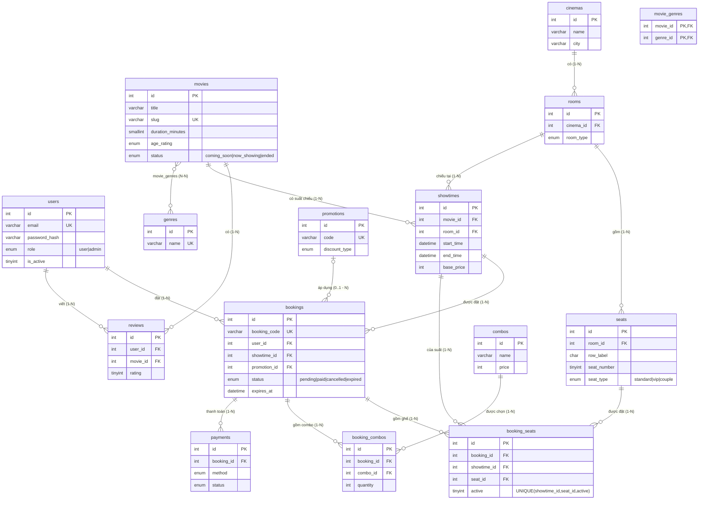

# ERD - movie_booking

Xem sơ đồ: dán khối `mermaid` bên dưới vào https://mermaid.live hoặc mở file này bằng VS Code (cài extension "Markdown Preview Mermaid Support").

## Quan hệ chính
| Loại | Quan hệ |
|---|---|
| 1-N | users→bookings, movies→showtimes, cinemas→rooms, rooms→seats, rooms→showtimes, bookings→booking_seats/booking_combos/payments |
| N-N | movies ↔ genres (qua movie_genres), bookings ↔ seats (qua booking_seats), bookings ↔ combos (qua booking_combos) |
| 1-1 (logic) | 1 ghế trong 1 suất chiếu chỉ thuộc 1 booking đang hoạt động (ràng buộc UNIQUE) |

## Cơ chế chống đặt trùng ghế
`booking_seats` có `UNIQUE(showtime_id, seat_id, active)`:
- Ghế đang giữ/đã bán: `active = 1` → DB không cho chèn dòng thứ 2 cùng suất + cùng ghế.
- Khi hủy/hết hạn: `UPDATE booking_seats SET active = NULL WHERE booking_id = ?` → ghế được nhả, vẫn giữ lịch sử (MySQL/MariaDB cho phép nhiều giá trị NULL trong UNIQUE).
- Giai đoạn 4 sẽ kết hợp thêm transaction + `SELECT ... FOR UPDATE` để lỗi báo thân thiện hơn.

## Luồng trạng thái booking
`pending` (giữ ghế, có `expires_at`) → `paid` (thanh toán thành công) | `cancelled` (người dùng hủy) | `expired` (quá hạn, cron nhả ghế)
